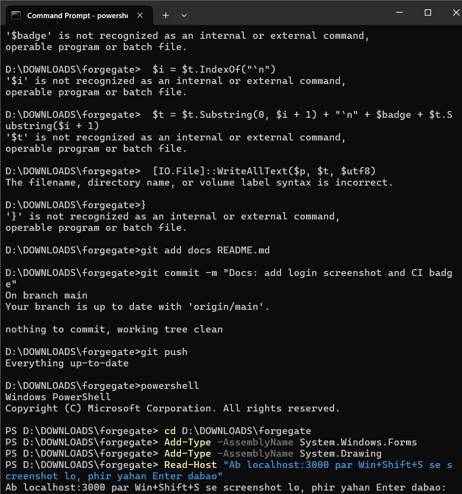

# ForgeGate — Access Governance





ForgeGate is a Spring Boot + React application for time-bound access requests, manager/security approvals, automatic grants and expiry, and append-only audit trails. It is a development baseline; complete the owner steps below before production use.

## Architecture

```text
Browser
  React + Vite (served by Nginx; SPA fallback)
          │ same-origin /api proxy
          ▼
  Spring Boot REST API ── JWT / role checks / state machine
       │            │
       ▼            ▼
 PostgreSQL       Redis
 (Flyway schema,  (request/approval locks,
  requests, grants, expiry-scheduler lock,
  approvals, logs) resource-policy cache,
                   login rate limit)
       │
       └── scheduled expiry worker (distributed Redis lock)
```

Security decisions are enforced in the backend. Frontend navigation is only a convenience and is not an authorization boundary. The API is stateless: bearer JWTs are checked on every request, and the current active role is reloaded from PostgreSQL rather than trusted from a potentially stale role claim.

## Quick start with Docker Compose

1. Install Docker Engine/Desktop with Compose v2.
2. Copy `.env.example` to `.env` and replace all sample values. Generate a JWT key with `openssl rand -base64 48`.
3. Run:

   ```bash
   docker compose up --build
   ```

4. Open `http://localhost:3000`. The backend health endpoint is proxied at `http://localhost:3000/api/health`.
5. Open API documentation at `http://localhost:3000/swagger-ui.html`.

Compose waits for PostgreSQL and Redis health before starting the API, then waits for API health before starting Nginx. PostgreSQL and Redis data are stored in named volumes. For a clean local reset, stop the stack and remove volumes with `docker compose down -v` (this deletes local data).

### Local development without Docker

You need Java 21, Maven 3.9+, Node 22, PostgreSQL 16+, and Redis 7+. Create a database and Redis instance, export the variables in `.env.example` into your shell, then:

```bash
cd backend
mvn -B test
mvn spring-boot:run
```

In another terminal:

```bash
cd frontend
npm install
npm test
npm run build
npm run dev
```

Vite proxies `/api`, `/swagger-ui`, and `/v3/api-docs` to `http://localhost:8080` in development. Flyway owns the database schema; do not run a separate `schema.sql` initializer.

## Development seed accounts

All seed accounts use the same **development-only** BCrypt hash. Password: `password`.

| Role | Email | Intended use |
|---|---|---|
| EMPLOYEE | `employee@forgegate.local` | Create and track requests |
| MANAGER | `manager@forgegate.local` | Review the employee's manager stage |
| SECURITY_REVIEWER | `security@forgegate.local` | Review high-sensitivity access and revoke grants |
| ADMIN | `admin@forgegate.local` | Manage users, resources, and policies; handle null-manager escalation |

These credentials are unsafe outside local development. Disable/remove seed accounts or rotate every password before deployment. Never use the sample `.env` values on a shared host.

## Environment variables

| Variable | Purpose |
|---|---|
| `JWT_SECRET` | Required HMAC signing secret; at least 32 bytes. Never commit a real value. |
| `JWT_EXPIRY_MINUTES` | JWT lifetime; defaults to 60. |
| `CORS_ORIGINS` | Comma-separated exact browser origins; no wildcard is configured. |
| `POSTGRES_DB` | Database name (default `forgegate`). |
| `POSTGRES_USER` | Database user (default `forgegate`). |
| `POSTGRES_PASSWORD` | Required database password. |
| `SPRING_DATASOURCE_URL` | JDBC URL for non-Compose/local deployment. |
| `SPRING_DATASOURCE_USERNAME` / `SPRING_DATASOURCE_PASSWORD` | JDBC credentials. |
| `SPRING_DATA_REDIS_HOST` / `SPRING_DATA_REDIS_PORT` / `SPRING_DATA_REDIS_PASSWORD` | Redis connection settings. |
| `REDIS_PASSWORD` | Required Redis password in Compose. |
| `FORGEGATE_REVOKE_INTERVAL_MS` | Expiry scheduler interval; defaults to 60 seconds. |
| `DB_POOL_SIZE` | JDBC connection pool maximum size; defaults to 10. |
| `SERVER_PORT` | API port; defaults to 8080. |
| `VITE_API_URL` | Optional frontend API base URL; defaults to `/api`. |

## Request lifecycle and policy decisions

```text
PENDING_MANAGER ── approve ──► PENDING_SECURITY ── approve ──► APPROVED ──► ACTIVE
       │                               │                                  │
       └── reject ──► REJECTED         └── reject ──► REJECTED            ├──► EXPIRED
                                                                          └──► REVOKED
```

The `RequestStateMachine` contains the explicit allowed-transition map. Illegal transitions return HTTP 409, and `REJECTED`, `EXPIRED`, and `REVOKED` are terminal request states. HIGH-sensitivity resources require security review even if a policy's boolean is false. An approval to the final `APPROVED` state creates the grant and changes the request to `ACTIVE` in the same transaction; there is no separate manual grant action because approval should not leave an approved request waiting indefinitely for a second operator.

If the requester has `manager_id = NULL`, the request remains in `PENDING_MANAGER` but is assigned to the first active `ADMIN`, and an audit event `MANAGER_ESCALATED_TO_ADMIN` is written. This is a deliberately simple fallback policy and can be changed to a dedicated queue or a configured escalation group later. If there is no active administrator, creation fails safely with HTTP 503 rather than silently bypassing approval.

Revocation sets both `access_grants.status = 'REVOKED'` and `access_requests.status = 'REVOKED'`; the request schema explicitly allows `REVOKED` rather than misrepresenting revocation as expiry.

A user cannot request the same resource when an active grant or an open request already exists. A partial unique index independently enforces one active grant per user/resource. A client supplies an idempotency key; duplicate submissions by the same requester return the existing request. Redis locks serialize request creation and approval for the same user/resource. A Redis lock also prevents multiple scheduler instances from running expiry concurrently. Redis failures fail closed with an explicit service-unavailable response. Resource/policy lookups are cached in Redis for five minutes and admin edits evict the cache.

## API overview

All endpoints except `/api/health`, `/api/auth/login`, and the OpenAPI docs require `Authorization: Bearer <JWT>`.

| Endpoint | Access / behavior |
|---|---|
| `POST /api/auth/login` | Email/password login; BCrypt verification; Redis rate limit |
| `GET /api/auth/me` | Current authenticated user |
| `GET /api/catalog/resources` | Active resources for request forms |
| `POST /api/requests` | Create a request; identity always comes from JWT |
| `GET /api/requests/mine` | Current user's requests |
| `GET /api/requests/pending-for-me` | Approval rows assigned to current user |
| `POST /api/requests/{id}/approve` | Assigned manager or assigned security reviewer stage only |
| `POST /api/requests/{id}/reject` | Same ownership checks; requires a non-empty `comment` |
| `GET /api/grants/mine` | Current user's active grants |
| `GET /api/grants/expiring-soon` | Current user's grants expiring within seven days |
| `GET /api/grants/all` | ADMIN / SECURITY_REVIEWER active-grant view |
| `POST /api/grants/{id}/revoke` | ADMIN / SECURITY_REVIEWER only |
| `GET /api/notifications` | Current user's notifications |
| `POST /api/notifications/{id}/read` | Mark own notification read |
| `GET /api/dashboard/summary` | Current user's dashboard counts and expiring grants |
| `GET /api/audit` | ADMIN / SECURITY_REVIEWER; filters `actor`, `action`, `entity`, `from`, `to`, `page`, `size` |
| `/api/admin/resources` | ADMIN CRUD; DELETE is a soft delete (`is_active=false`) |
| `/api/admin/policies` | ADMIN CRUD; DELETE is a soft delete |
| `/api/admin/users` | ADMIN CRUD; DELETE is a soft delete |

Errors use `{ "timestamp": "...", "status": 400, "message": "...", "path": "/api/..." }`; stack traces are not returned. The API uses HTTP 401 for unauthenticated/invalid credentials, 403 for authorization failures, 409 for state conflicts, and 503 when Redis-backed safety controls are unavailable.

## Database migrations

Flyway migrations live in `backend/src/main/resources/db/migration`:

- `V1__schema.sql`: normalized schema, constraints, workflow indexes, grant expiry index, and partial unique active-grant index.
- `V2__seed.sql`: development roles, users, resources, and policies with BCrypt password hashes.
- `V3__audit_append_only.sql`: PostgreSQL trigger that raises an exception on any `UPDATE` or `DELETE` of `audit_logs`.

## Tests and verification

Backend tests include transition-map and policy-engine unit tests plus Testcontainers integration coverage for idempotency, partial unique grant enforcement, append-only audit logs, the expiry scheduler, full manager/security/grant/expiry path, rejection/comment checks, null-manager escalation, wrong-manager/self-approval blocks, and HTTP 401/403 behavior. Frontend tests cover login submission, disabled request submit while pending/idempotency key, and reject-comment validation.

Run the verification commands listed below in an environment with network access and Docker:

```bash
cd backend && mvn -B test
cd ../frontend && npm install && npm test && npm run build
cd .. && docker compose up --build
```

A green unit test suite alone does not prove production readiness. Exercise a full login/request/approval/rejection path against the composed stack and inspect logs before deployment.

## MANUAL STEPS FOR THE OWNER

1. **Secrets:** replace all `.env` values; generate `JWT_SECRET` using a cryptographically secure random generator; rotate PostgreSQL and Redis credentials. Do not commit `.env`.
2. **Domain and TLS:** set the production hostname, terminate TLS at a trusted reverse proxy/load balancer, and restrict network access to PostgreSQL/Redis. Compose intentionally does not publish database or Redis ports to the host.
3. **Hosting:** configure persistent encrypted volumes, backups, restore drills, resource limits, monitoring, log retention, and a rollback plan. Run multiple API replicas only with shared Redis and PostgreSQL.
4. **SMTP / delivery:** notifications currently persist in-app only. Configure and test SMTP or an approved messaging provider if email delivery is required; add retry/dead-letter handling before relying on outbound notifications.
5. **CI secrets:** store deployment credentials in GitHub Actions secrets/environments; the CI test JWT secret is a test-only value. Protect the default branch and require reviewed changes.
6. **First-run verification:** confirm migrations and health checks, sign in with each development role, verify manager/security authorization, reject a request with/without a comment, revoke and expire a grant, and inspect audit rows. Then rotate or remove seed users.
7. **Security review:** perform dependency/container scanning, penetration testing, threat modeling, backup/restore review, and a least-privilege review. Review rate-limit thresholds and trusted proxy headers. No real downstream GitHub/cloud/database permission provisioning connector is included; the grant is ForgeGate's internal entitlement record until a provisioning adapter is added.
